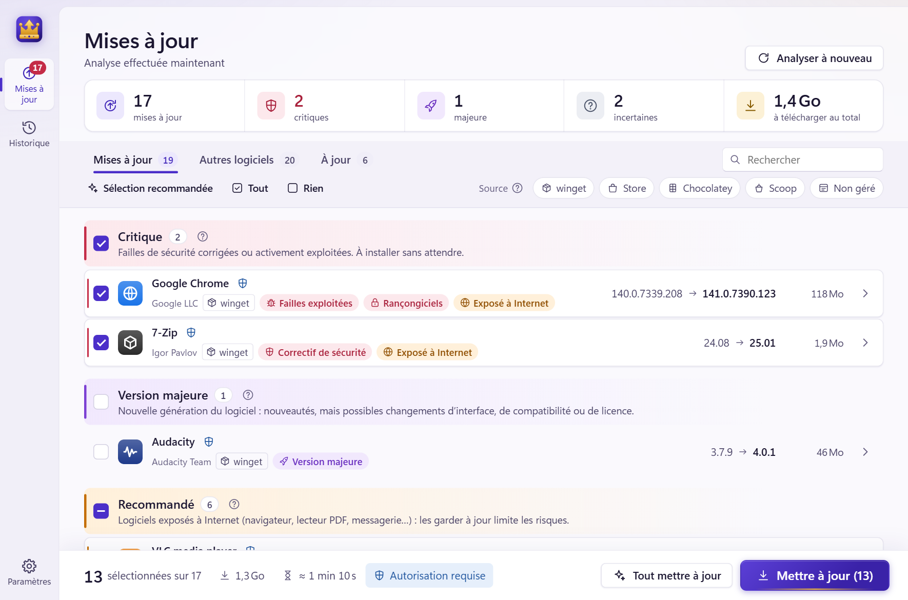
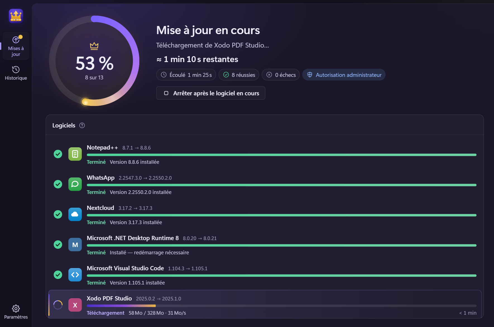
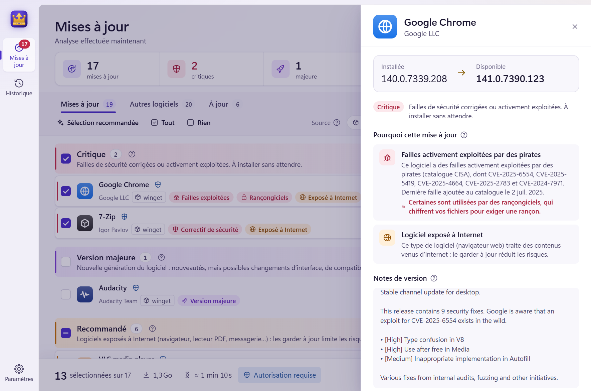
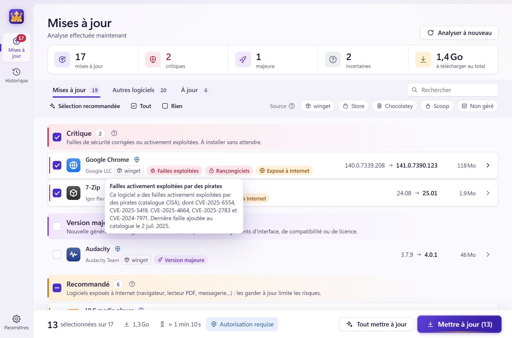
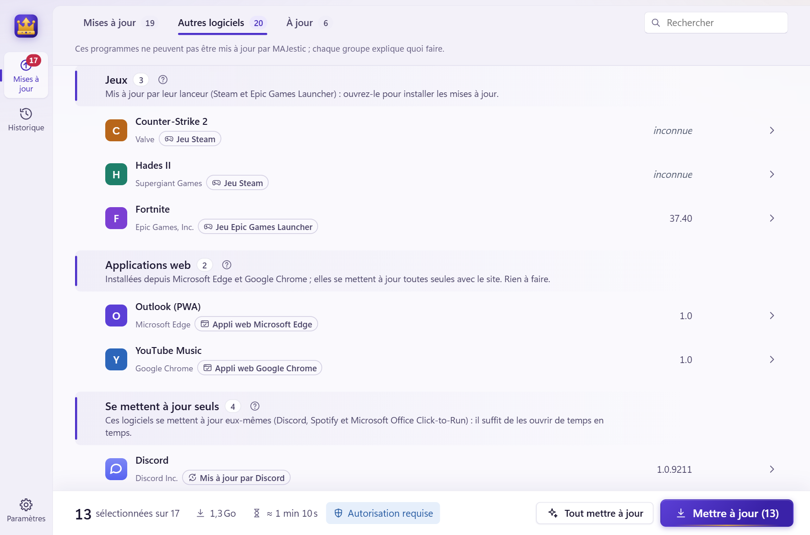
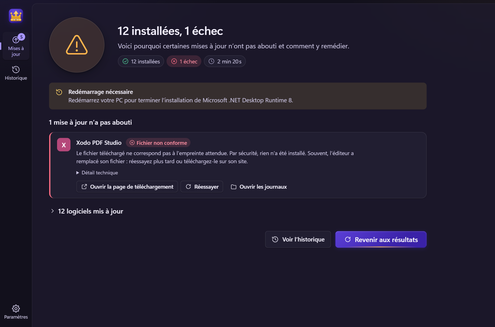

<p align="center">
  
</p>

<h1 align="center">MAJestic</h1>

<p align="center">
  <b>Toutes vos mises à jour, majestueusement.</b><br>
  <i>All your software updates, majestically.</i>
</p>

<p align="center">
  <a href="https://github.com/Belenos-Toutatis/MAJestic/releases/latest"><b>⬇ Télécharger / Download MAJestic.exe</b></a>
</p>

<p align="center">
  
  
</p>

---

🇫🇷 [Français](#-français) · 🇬🇧 [English](#-english)

## 🇫🇷 Français

**MAJestic** met à jour en une fois tous les logiciels de votre PC Windows 11.
C'est un programme **portable** : un seul fichier `.exe`, rien à installer.

### Ce qu'il fait

- **Trouve les mises à jour** de vos logiciels via **winget** (le gestionnaire de
  paquets de Windows), le **Microsoft Store**, **Chocolatey** et **Scoop** s'ils
  sont présents.
- **Vous conseille** : chaque mise à jour est classée.
  - 🔴 **Critique** : faille de sécurité activement exploitée (catalogue CISA KEV)
    ou correctif de sécurité annoncé dans les notes de version ;
  - 🟣 **Évolution majeure** : nouvelle version majeure, à décider en connaissance de cause ;
  - 🟠 **Recommandée** : logiciel exposé à Internet (navigateur, lecteur PDF, messagerie…) ;
  - ⚪ **Courante** ; 🔘 **À vérifier** quand la version installée est inconnue.
- **Installe tout en un clic**, ou seulement votre sélection, avec **une seule
  demande d'autorisation administrateur** pour tout le lot.
- **Ferme puis relance** les logiciels ouverts qui bloqueraient leur mise à jour
  (après vous avoir demandé), sans jamais les relancer en administrateur.
- **Progression en direct** : barre globale et barre par logiciel, avec un
  **temps restant réaliste** (taille réelle des installateurs, débit mesuré,
  durées observées sur votre PC lors des mises à jour précédentes).
- **Gère les cas difficiles** :
  - version installée inconnue → lecture de la version dans le fichier du
    programme, ou réinstallation de la dernière version ;
  - logiciel inconnu des gestionnaires de paquets → recherche d'une version plus
    récente (GitHub, catalogue Chocolatey), lien vers le site de l'éditeur ;
  - jeux, applications web, pilotes, logiciels qui se mettent à jour seuls →
    expliqués et rangés à part ;
  - téléchargement refusé, application ouverte, redémarrage nécessaire… →
    explication claire et solution proposée.
- **Revenir à une version précédente** depuis l'historique (winget et Chocolatey).
- **Vérification planifiée** (quotidienne, hebdomadaire ou mensuelle) avec une
  notification Windows quand une mise à jour importante est disponible.
- **Aucune aide nécessaire** : chaque élément de l'interface s'explique au
  survol. Thème clair, sombre ou automatique ; français et anglais.

### Captures d'écran

| | |
|---|---|
|  |  |
| *Le détail explique pourquoi une mise à jour compte.* | *Chaque élément s'explique au survol.* |
|  |  |
| *Les logiciels qu'aucun outil ne gère sont rangés et expliqués.* | *Le bilan propose une solution pour chaque échec.* |

### Utilisation

1. Téléchargez `MAJestic.exe` depuis les [Releases](https://github.com/Belenos-Toutatis/MAJestic/releases/latest).
2. Lancez-le. L'analyse démarre toute seule (quelques secondes).
3. Vérifiez la sélection proposée, puis cliquez sur **Mettre à jour**.

> Windows SmartScreen peut afficher « Windows a protégé votre ordinateur » car
> l'exécutable n'est pas signé : cliquez sur *Informations complémentaires* puis
> *Exécuter quand même*. Vous pouvez vérifier le fichier avec l'empreinte SHA-256
> publiée à côté.

**Prérequis** : Windows 10 ou 11 avec winget (« Programme d'installation
d'application », présent par défaut sur Windows 11) et WebView2 (présent par défaut).

### Confidentialité

MAJestic télécharge des catalogues publics (failles exploitées de la CISA,
manifestes winget, catalogue Chocolatey, versions GitHub). **La liste de vos
logiciels n'est jamais envoyée nulle part** : chaque requête ne concerne qu'un
seul logiciel. Les sources en ligne peuvent être désactivées dans les paramètres.
Réglages, historique et journaux restent sur votre PC, dans
`%LOCALAPPDATA%\MAJestic`.

## 🇬🇧 English

**MAJestic** updates every program on your Windows 11 PC in one go. It is
**portable**: a single `.exe`, nothing to install.

- Finds updates through **winget**, the **Microsoft Store**, **Chocolatey** and **Scoop**.
- Ranks them: **critical** (actively exploited vulnerabilities from the CISA KEV
  catalog, security fixes in release notes), **major**, **recommended**
  (Internet-exposed software), **normal**, **to check** (unknown installed version).
- Installs everything or your selection with **a single UAC prompt**; closes and
  relaunches running programs (never elevated).
- Live progress per program and overall, with a **realistic time remaining**
  learned from your own PC.
- Handles hard cases: unknown versions (read from the executable), programs no
  package manager knows (GitHub / Chocolatey lookups, publisher site), refused
  downloads, running apps, reboots.
- Roll back to a previous version from the history; scheduled checks with Windows
  notifications; light/dark/auto theme; French and English; every control
  explains itself with a tooltip.
- Privacy: public catalogs are downloaded; your software list is never sent anywhere.

Download `MAJestic.exe` from the [Releases](https://github.com/Belenos-Toutatis/MAJestic/releases/latest)
and run it.

## Développement / Development

Rust (engine) + [Tauri 2](https://tauri.app) (WebView2 UI, plain HTML/CSS/JS, no build step).

```bash
cargo test --workspace
cargo build --release -p majestic   # → target/release/MAJestic.exe
```

The UI can be previewed in a browser with a mock backend: serve `ui/` with any
static server (`python -m http.server -d ui`) and open it.

See [docs/ARCHITECTURE.md](docs/ARCHITECTURE.md) for the design (modules,
UI ↔ backend API, elevated worker, time estimates).

## Licence / License

[MIT](LICENSE) © 2026 Belenos Toutatis
